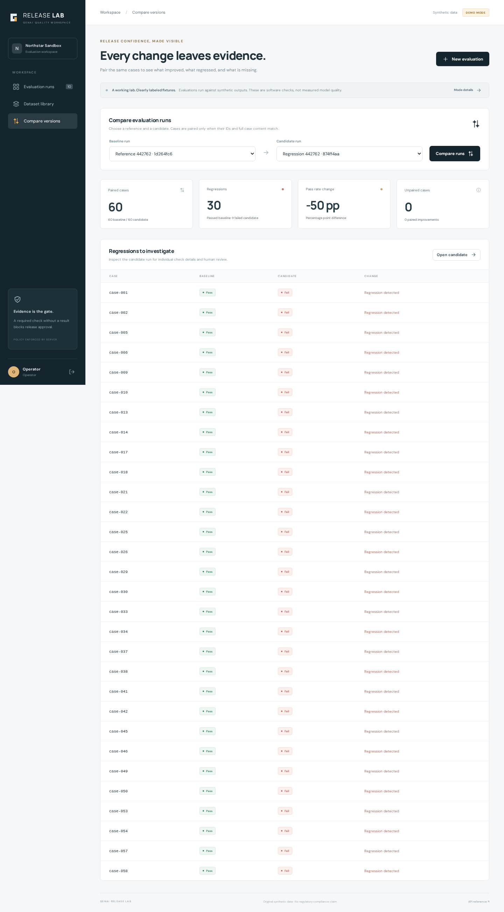

# GenAI Release Lab

A release-evaluation workbench for the fictional **Aster Systems** organization, shown in the UI as the **Northstar Sandbox** workspace. Import or execute outputs, inspect failures, compare compatible cases and enforce release gates. All included cases and responses are original synthetic material; their results are software checks, not model-quality or regulatory-compliance claims.



Next.js/React/TypeScript frontend, FastAPI backend, PostgreSQL and a durable worker. The [technical audit](docs/audit.md) records reproduced defects, corrections, real browser captures and clean Docker verification. [Leer en español](docs/GUIA_ES.md).

## Install and start DEMO

Install [Docker Desktop](https://docs.docker.com/get-started/get-docker/) or Docker Engine with the Compose v2 plugin, and Git. Start Docker and leave port **3103** free. The container path does **not** require host Python, Node, API keys or an `.env` file. The first build downloads pinned dependencies and base images.

```bash
git clone https://github.com/giovannyTorres/genai-release-lab.git
cd genai-release-lab
docker compose up --build -d --wait
```

Open **http://localhost:3103**. PostgreSQL migrations and idempotent seed run automatically. `--wait` waits for service healthchecks; `docker compose ps` shows the state. DEMO never calls model APIs, even when keys happen to be configured.

All three local DEMO accounts use password **`demo-release`**:

| Account | Allowed actions |
|---|---|
| `operator` | Version datasets/policies, import outputs and run evaluations |
| `reviewer` | Append human reviews and approve an eligible completed run |
| `viewer` | Read datasets, runs and comparisons |

These public credentials are for the local demonstration. The web port binds to loopback, and permissions are enforced by the backend.

## Try the main workflow in two minutes

1. Sign in as **operator**. Click **New evaluation**, select **Aster assurance suite**, **Deterministic gate** and **Reference · expected behavior**, then start the run. Expect **60/60 passed, Approved**.
2. Create a second run with **Regression · deliberate failures**. Expect **30/60 passed, Rejected**. Open a failed case to inspect its output, expectation and checks.
3. Open **Compare versions**, select the reference and regression runs, then **Compare runs**. Inspect the paired denominator and 30 regressions; export JSON, JUnit or HTML from a run. Changed case contracts and missing evidence are shown explicitly.
4. Run the reference with **Grounding required**. Its mandatory LLM evaluation remains **pending** and the decision **Inconclusive** without a LIVE judge; approval stays blocked.
5. **Sign out**, sign in as **reviewer**, and open the completed reference run to record a human review and approve it. Human corrections preserve the automated evidence.

See the [timed walkthrough](docs/DEMO.md) and [fixture formats](fixtures/README.md) for presentation and import details. API documentation is available through the same origin at [localhost:3103/api/docs](http://localhost:3103/api/docs).

## Stop, resume and troubleshoot

```bash
docker compose down                  # Stops services; keeps PostgreSQL data.
docker compose up -d --wait           # Resumes using existing images and data.
```

Runs, datasets and reviews survive restarts. `docker compose down -v` **deletes** the named database volume; it is not a normal stop command.

If startup fails, inspect `docker compose ps` and `docker compose logs --tail=80 migrate api worker web`. A port conflict requires freeing port 3103. A failed registry download requires restoring network access and rerunning the build. Managed environments with a custom trusted CA can use the documented [CA override](docs/OPERATIONS.md); do not disable TLS. The earlier HTTP503 outage is historical: the audit subsequently completed fresh uncached builds and startup on a new volume.

## Quick correctness check without Docker or credentials

For this optional path, install **Python 3.12**, [uv](https://docs.astral.sh/uv/getting-started/installation/) **0.13.4** and GNU Make (Linux/macOS/WSL). Run from the repository root:

```bash
uv sync --frozen
make quickcheck
```

Expect **5 passed**. This reuses existing tests for calculated fixture results, persisted evaluation/export/reviewer approval, blocked pending approvals, CLI exit codes and configuration hashes. The target explicitly uses a temporary SQLite database; no application server, PostgreSQL, Node or model credentials are needed. It is a focused check, not a substitute for the full suite or Docker/browser validation.

To inspect a report directly:

```bash
uv run --frozen release-lab --dataset fixtures/cases.json --outputs fixtures/reference.json --export /tmp/release-reference.json
```

CLI exit codes are **0 approved**, **2 rejected**, **3 inconclusive**, **4 invalid input**. `fixtures/regression.json` intentionally returns 2. Adding `--require-llm` returns 3 because the offline CLI does not run a judge. The quick check treats these expected gate outcomes as successful assertions.

## Compare semantic retrieval changes

The [three-arm benchmark runner](docs/SEMANTIC_BENCHMARK.md) compares baseline, a reviewed glossary and Auto Ontology through typed local adapters or recorded observations. It preserves frozen sources/configuration hashes, per-case traces, import-compatible JSONL and optional typed SQL-result checks. Fixture, mock, missing or mandatory-pending observations keep the affected comparison inconclusive. A complete live baseline/glossary pair can be measured independently of unavailable NVIDIA. The included contract example needs no services or credentials; it deliberately leaves NVIDIA unavailable.

```bash
uv run python -m release_lab.semantic_benchmark --plan fixtures/semantic-benchmark/plan.json --output-dir .run/contract-run-01
# Expected exit 3 (inconclusive); use a new directory for each run.
uv run python -m release_lab.semantic_benchmark --verify --output-dir .run/contract-run-01
```

The external runner's SQL checks and manifest are not enforced by the existing server import gate. See the guide for caller contracts, authorization provenance, measured scope and import boundaries.

## Full development checks

Host development additionally uses **Node 24.22.1**. Exact Python/npm versions are recorded in `uv.lock` and `apps/web/package-lock.json`. From the repository root:

```bash
uv sync --frozen
(cd apps/web && npm ci)
make lint types test build
```

The default backend suite uses disposable SQLite. PostgreSQL tests require a **separate disposable database** selected by `TEST_DATABASE_URL`, with a name ending `_test`; tests recreate its schema. Ordinary application `DATABASE_URL` is ignored by the harness. See [audit reproduction](docs/audit.md) for exact isolated PostgreSQL commands and recorded results.

With DEMO already running at port 3103, install Chromium and run the browser journeys:

```bash
(cd apps/web && npx playwright install --with-deps chromium)
(cd apps/web && npm run test:e2e)
```

On Linux, installing browser system dependencies may require administrator privileges. Set `E2E_URL` when using a different application port. Eight browser scenarios use the actual backend; three explicitly mock mode/login responses. CI runs the full backend, frontend and Docker/browser checks without model credentials.

## Run development services separately

This is an alternative to the all-container application. Do not start both on the same web port. With the host tools above installed, start only PostgreSQL and prepare its schema:

```bash
docker pull postgres:17.6-bookworm
docker compose -f compose.yaml -f infra/compose.local.yaml up -d --wait db
uv sync --frozen
uv run alembic upgrade head
uv run python -m release_lab.seed
```

Then keep three terminals open at the repository root:

```bash
# Terminal 1
uv run uvicorn release_lab.main:app --host 127.0.0.1 --port 8103
# Terminal 2
uv run python -m release_lab.worker
# Terminal 3
(cd apps/web && npm ci && npm run dev)
```

The default local database uses port 5543, API 8103 and web 3103. Ctrl+C stops each application process; stop the database with `docker compose -f compose.yaml -f infra/compose.local.yaml down`, preserving its volume. The optional `./scripts/demo-local.sh` bundles production local processes but requires prepopulated frozen Python/npm caches; its prerequisites and verification limits are documented in [operations](docs/OPERATIONS.md).

## LIVE and review boundaries

DEMO exercises persistence, authorization, deterministic evaluators, approvals and workers using imported or explicit fixture outputs. LIVE uses implemented **official OpenAI Responses and Gemini SDK adapters**, or authorized registered HTTPS endpoints; it never silently falls back to fixtures. Sixty synthetic cases are split into 40 development and 20 final cases. Comparisons require matching IDs and full case contracts; pending evidence blocks a measured delta and mandatory pending checks block approval.

No keys are needed to install, demonstrate or test this repository. When credentials become available, follow the exact [LIVE configuration and opt-in smoke commands](docs/OPERATIONS.md). Secrets belong only in backend configuration. Provider contracts are tested with simulated transports; **real model-service acceptance and model quality remain unverified**. Endpoint evaluation requires authorized destinations and direct egress. Azure files are configuration, not evidence of a deployment.

For a technical interview, start with [architecture and decisions](docs/ARCHITECTURE.md), [security/trust boundaries](docs/SECURITY.md), [verification evidence](docs/VERIFICATION.md) and the [audit](docs/audit.md). The project is a portfolio demonstration with documented limits, not a production-readiness claim.
