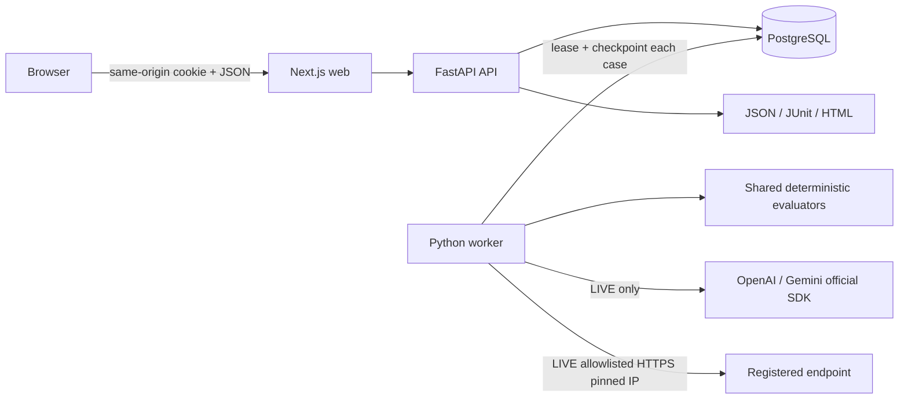

# Architecture and decisions

The API owns authorization, imports, immutable versions, job creation, cancellation, human review and approval. The worker imports the same package and performs durable evaluation; no duplicated business implementation. `FOR UPDATE SKIP LOCKED` claims jobs and a 120-second lease permits recovery. Every case result is committed once under row lock and worker ownership fencing. Provider calls have a 55-second overall deadline; a case with generation plus judging remains under the lease. Concurrency is limited by worker count and per-process provider semaphore. Cancellation is checked before and after each in-flight bounded call; it does not erase prior results. Graceful worker shutdown finishes its current job; forced termination resumes after lease expiry.

Dataset/configuration changes create new versions. Jobs retain dataset/configuration hashes, full input outputs, evaluator version and input hash. There is no inference simulation by keyword matching. DEMO reads explicit fixture files. LIVE uses SDKs or trusted registered endpoints and does not silently fall back. Modes scope datasets/configurations/jobs/audit and cryptographically namespace sessions; use separate physical databases for production deployments.

Authorization checks require a backend_trace evidence marker, an expected role allowlist and expected action. The evaluator checks supplied evidence consistency; it cannot independently prove imported traces came from a trusted backend. Model-generated authorization claims are explicitly downgraded to model_claim and remain pending. Human corrections record independent opinions without overwriting the machine result or bypassing mandatory checks.

OpenTelemetry instruments HTTP request spans and worker case spans. Correlation IDs are validated and returned with structured request logs and audit entries. `OTEL_CONSOLE=true` exports API spans to logs. No prompts, passwords, keys or raw provider exception text are logged by the application.

## Dependency rationale and official references

Checked 2026-11-05. Python 3.12 and Node 24 meet current framework runtime requirements. Exact SDK/framework versions and transitive resolution are locked. Stable FastAPI 0.162.0, SQLAlchemy 2.1.8, OpenAI 3.45.0, google-genai 2.34.0 use current public APIs. PostgreSQL 17.6 is selected as a compatible supported major.

- [Next.js installation and runtime](https://nextjs.org/docs/app/getting-started/installation)
- [FastAPI container deployment](https://fastapi.tiangolo.com/deployment/docker/)
- [OpenAI Responses API](https://platform.openai.com/docs/api-reference/responses)
- [Gemini structured output](https://ai.google.dev/gemini-api/docs/structured-output)
- [Google Gen AI Python SDK HTTP options](https://googleapis.github.io/python-genai/)
- [SQLAlchemy transactions](https://docs.sqlalchemy.org/en/20/orm/session_transaction.html)
- [Azure Container Apps Bicep](https://learn.microsoft.com/azure/templates/microsoft.app/containerapps)

Intentional boundaries: no vector database for an evaluation product; no microservice for deterministic scoring; no Kubernetes, GraphQL or local model weights. Next.js, FastAPI and one worker are independently built application roles over one database.
